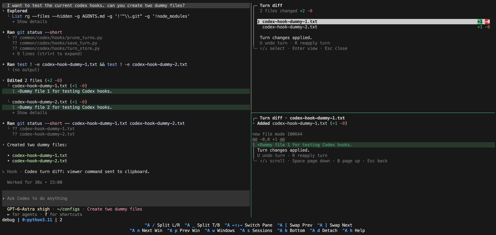

# Common Configurations

Shared configurations, scripts, and agent tooling used across platforms.

## Directories

| Directory | Purpose |
| --- | --- |
| [bin](./bin) | Shared helper executables, including `clipboard-copy` for cross-platform `tmux` clipboard copying. |
| [claude](./claude) | Claude Code configuration (`settings.json`). |
| [codex](./codex) | Codex CLI configuration, rules, and documentation — see [codex/README.md](./codex/README.md). |
| [containers](./containers) | Dev container templates (`ubuntu` and `ubuntu-gpu`) for isolated Ubuntu environments. |
| [gemini](./gemini) | Antigravity (`agy`) configuration (`AGENTS.md`, `settings.json`, `hooks.json`, and sensitive-file hook). |
| [git](./git) | Shared Git configuration and global ignore template. |
| [hooks](./hooks) | Shared agent hooks, including the [turn-diff viewer](./hooks/turn-diff). |
| [install](./install) | Cross-platform setup scripts invoked by the OS-specific installers. |
| [screen](./screen) | GNU Screen configuration (`.screenrc`). |
| [skills](./skills) | Shared agent skills, including [operate-tart-vm](./skills/operate-tart-vm/SKILL.md). |
| [tmux](./tmux) | `tmux` configuration (`tmux.conf`) and SSH agent forwarding helper (`update-ssh-agent`). |
| [vms](./vms) | Packer templates and host configuration scripts for isolated VMs (such as the [macOS Tart VM](./vms/macos)). |
| [zsh](./zsh) | Shared Zsh configuration, aliases, functions, history tools, and plugins — see [zsh/README.md](./zsh/README.md). |

## Review changes after each request

The [turn-diff viewer](./hooks/turn-diff) lets you check what changed in a Codex
or Antigravity CLI turn. It lists the affected files and opens a colored diff
for each file.

After a CLI turn finishes, run the copied command in a terminal to open the
viewer. Press **U** to undo all changes from that turn, or **R** to reapply
them.

### Keep recent reviews

Saved reviews for sessions with no updates in the past 30 days are automatically
removed from that repository.

To change the period, edit `--retention-days 30` in the `prune_turns.py` command
in [common/codex/hooks.json](./codex/hooks.json) and
[common/gemini/hooks.json](./gemini/hooks.json).

## Ubuntu containers

Use the [Ubuntu](./containers/ubuntu) or [GPU](./containers/ubuntu-gpu) template
when an agent needs full access. Copy its files into your project's `.devcontainer/`
to use it with VSCode Dev Containers.

## macOS VM

Run macOS tasks, including GUI operations, in a [VM](./vms/macos) to protect
your host machine. The supplied [operate-tart-vm skill](./skills/operate-tart-vm/SKILL.md)
makes it easier to operate the VM from supported agents.
