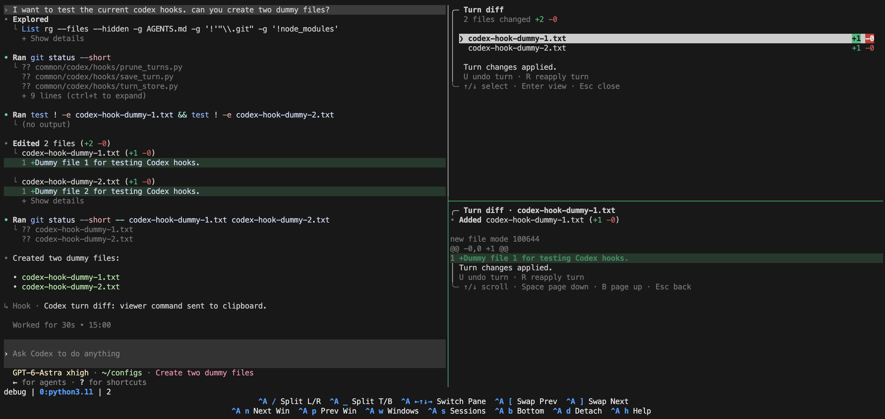

# Codex Tools and Configuration

This setup helps you review Codex's file changes and use your preferred working
style. For shared containers, VMs, and skills, see [common/README.md](../README.md).

## Review changes after each request

The turn-diff viewer lets you check what changed in a turn. It lists the affected files,
and lets you open a colored diff for each file.

After a CLI turn finishes, run the copied command in a terminal to open the viewer.
Press **U** to undo all changes from that turn, or **R** to reapply them.



### Keep recent reviews

When you submit a new CLI request, saved reviews for sessions with no updates
in the past 30 days are automatically removed from that repository.

To change the period, edit `--retention-days 30` in the `prune_turns.py` command in
[hooks.json](./hooks.json).

## Rules

[Rules](./rules) preapprove selected safe commands to reduce the automatic
approval reviewer's token usage.

## SQLite logging

[Disable diagnostic logging](./disable_sqlite_logging.py) to reduce disk writes.
Start Codex once, quit all Codex processes, then run:

```console
python3 ~/configs/common/codex/disable_sqlite_logging.py \
    "${CODEX_SQLITE_HOME:-${CODEX_HOME:-$HOME/.codex}}/logs_2.sqlite"
```
