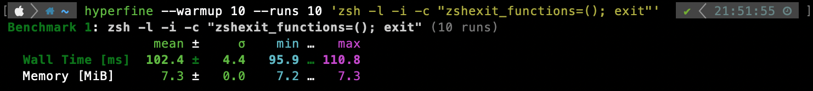

# Zsh

Shared zsh settings and scripts

## Directory structure

```text
common/zsh/
├── README.md
├── .zshrc
├── aliases.sh
├── functions.sh           # History/directory search and helper commands
├── functions/             # Shared helpers (load via autoload -Uz)
│   └── ...
├── history_codec.py       # Read/write history with multibyte text support
├── history_dedup.py       # Remove duplicate history entries
├── history_edit.py        # Edit zsh_history in any editor safely
├── history_prune.py       # prune failed commands from zsh_history
├── history_utils.py       # Shared history parsing helpers
└── sheldon/
    └── plugins.toml
```

## Setup

> [!IMPORTANT]
> If you want to use these dotfiles, review and customize the code.
> **Do not blindly use my settings unless you understand what they do.**

To configure just Zsh, run:

```console
zsh common/install/zsh.sh <Mac/Ubuntu/WSL>
```

For rootless Linux servers, follow the [server guide](../../Server/README.md).

### Prompt

Since [Powerlevel10k](https://github.com/romkatv/powerlevel10k) is used, select **MesloLGS NF Regular** in your terminal's font settings for prompt icons.

- macOS: follow the [font setup](../../Mac/README.md#fonts-and-apple-terminal).
- Ubuntu: run `zsh Ubuntu/install/fonts.sh`.
- WSL: install the font in Windows.

## Faster loading

### Methods

- Cache: cache generated sh files (e.g., for completion) via [`__update_cache`](functions/__update_cache)
- zcompile: overwrite builtin `source` and (z)compile all loaded files
- [Sheldon](https://sheldon.cli.rs/): a fast plugin manager

### Benchmark Results

See the [Zsh startup benchmark history](https://neko-nos.github.io/configs/dev/bench/zsh-startup/).

> [!NOTE]
> The published benchmark history and benchmark results shown on pull requests are measured on GitHub Actions runners, so they might be slower than the results on your local machine.
> As a local reference, on a Mac with Apple M2 and 16 GB memory, the results is as follows.



## Search and completion

[fzf](https://github.com/junegunn/fzf) is used by default. You can select another filter with `FILTER_CMD`.

| `bindkey` | Usage |
| --- | --- |
| Ctrl+R | History Search (supporting multi line commands etc) |
| Ctrl+P | Search and move to paths used recently |
| `...`, `....`, etc. | Expand to `../..`, `../../..`, etc |

## History

History is shared between sessions, with duplicate entries removed. Failed
commands are removed from saved history but remain available in the session.

- `zsh-history` prints saved commands as readable text.
- `zsh-history-edit` allows you to edit history in `$VISUAL`, or `$EDITOR` if `$VISUAL` is unset.

Use `zsh-history-edit` only when no other Zsh sessions are using the same history and run it **only once in a session**.

## Helper commands

| Command | Usage |
| --- | --- |
| `show-options` | Show Zsh option states. |
| `tree` | Limit [tree](https://oldmanprogrammer.net/source.php?dir=projects/tree) depth to two levels in `$HOME`. |
| `docker rebuild <image> <context>` | Delete and rebuild a [Docker](https://docs.docker.com/) image with the same tag. |
| `packer rebuild <vm> <template>` | Delete and rebuild VM with [Packer](https://developer.hashicorp.com/packer). |
| `tart run <vm>` | Share the current directory and run the [Tart](https://tart.run/) VM. |
